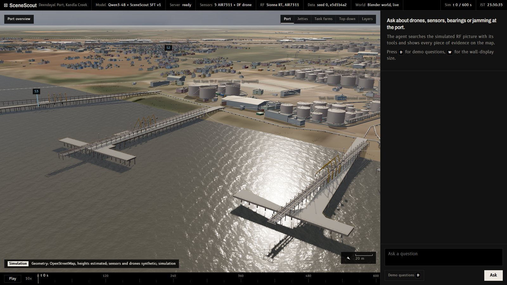
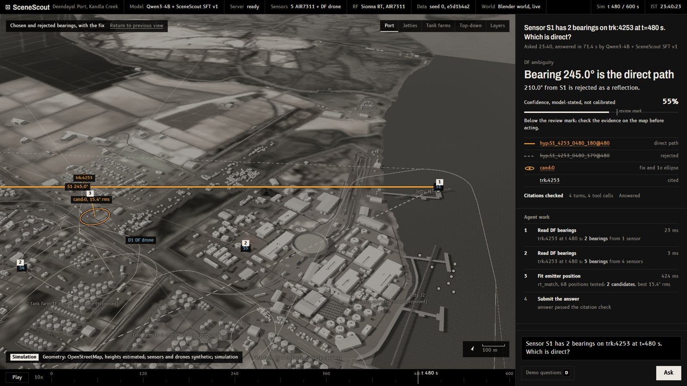
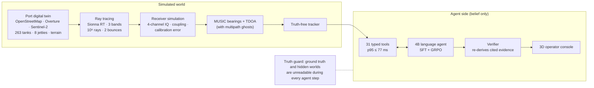
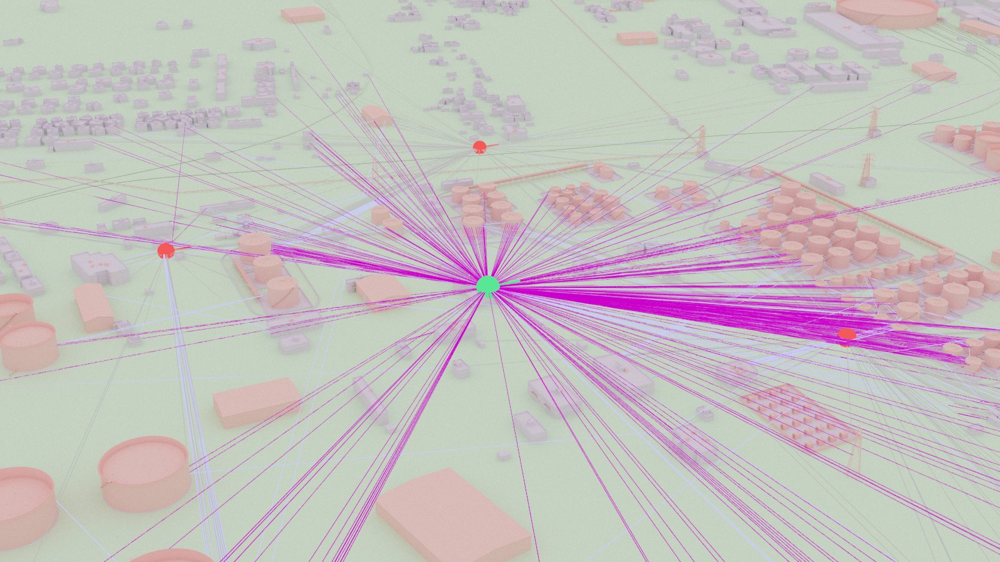
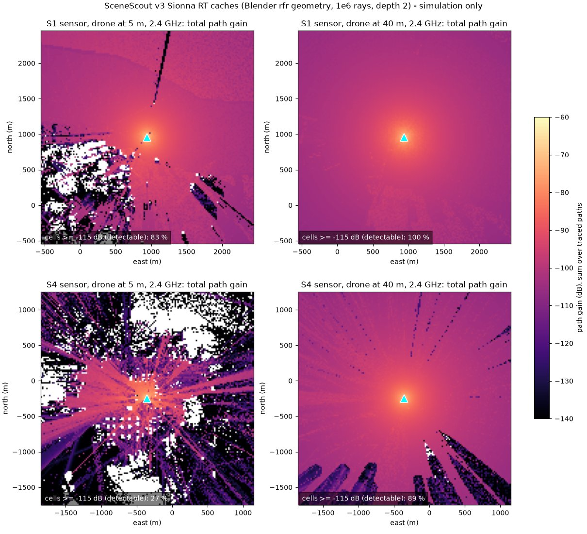

<div align="center">

# 🛰️ RF Spatial Grounding

### An AI analyst that finds drones it cannot see

*Ask a question in plain words. A small language-model agent investigates a ray-traced radio twin of a real port,
checks its own evidence, and answers on a 3D map.*


**[▶ Watch the 56-second demo](assets/demo.mp4)**

</div>

---

## The problem

Deendayal Port at Kandla Creek, on India's west coast, is one of the country's largest ports: oil jetties, tank farms
with hundreds of storage tanks, and a busy tidal creek. A small drone near such a site is hard to watch. No camera may
see it; it shows up only as radio energy, and that energy bounces off steel tanks, ships and water. A direction-finding
(DF) sensor can point at a reflection instead of the drone, two sensors can agree on a ghost, and a tracker can merge
two drones into one.

Spatial grounding benchmarks usually ask a model to find an object it can *see*. This project builds the case where the
object is **invisible**: the answer has to be reasoned out from imperfect radio evidence, and every claim has to be
traceable to that evidence.

## What it does

An operator types a question. A 4-billion-parameter language agent works it out the way an analyst would: it looks up
tracks, inspects bearings from each sensor, predicts how radio travels around the structures, fits candidate
positions, and only then answers, citing the evidence it used. An independent verifier re-derives that evidence before
the answer is accepted.

| Operator asks… | The agent… |
|---|---|
| *"Is any drone inside the tank-farm restricted zone right now?"* | finds the tracks, tests them against the zone at that time, cites the track references |
| *"Sensor S2 has two bearings on this track. Which one is direct?"* | predicts reflections from the ray-traced scene, fits candidates across sensors, rejects the ghost |
| *"Where should the DF drone fly next to pin down this emitter?"* | plans waypoints by expected uncertainty, flies them, reports the shrinking error ellipse |
| *"Where is our 5.8 GHz coverage weakest for low drones?"* | queries the coverage maps and proposes a new sensor site |
| *"Would jamming 900 MHz from S5 hit our own links?"* | computes the jamming footprint, lists affected links, and **asks the operator to confirm** |
| *"Where is the drone that landed on jetty 9?"* (no such thing) | says it **cannot determine** that, and why |

<table>
<tr>
<td width="50%"></td>
<td width="50%"></td>
</tr>
<tr>
<td align="center"><sub>The port, rendered live in the browser console</sub></td>
<td align="center"><sub>Direct path vs. reflection, resolved and drawn on the map</sub></td>
</tr>
</table>

## How it is built

The whole system runs on one laptop GPU, end to end, from map data to a trained agent.



1. **A digital twin of the port.** OpenStreetMap footprints, Overture buildings and Sentinel-2 imagery were turned into a
   detailed 3D model: 263 tanks in 8 tank farms, 8 jetties with piles and loading arms, 129 buildings, pipe racks,
   moored ships and terrain including the creek bed. Every object carries a material and a provenance tag. This one
   model is used for radio, simulation, tools and the console.
2. **A radio world on top of it.** Sionna RT ray-traces propagation between emitters and five DF sensors in three bands
   (sub-GHz, 2.4 GHz, 5.8 GHz). Per-antenna path coefficients drive an in-phase/quadrature simulation of a coherent
   four-channel receiver, including element coupling and calibration error. Bearings come from MUSIC; time differences
   from cross-correlation; a truth-free tracker fuses both into tracks.
3. **Scenarios and questions.** 324 scenario builds with drones, swarms and controllers flying scripted missions, and
   52 templated question families across seven areas (operator queries, DF ambiguity, replay, drone search, sensor
   siting, jamming collateral, unanswerable questions). Frozen test sets are hashed with their scorer.
4. **An agent trained for the job.** A scripted expert solves every family with the same tools the agent has. The 4B
   model (Qwen3-4B-Instruct) is fine-tuned with LoRA on the expert's investigations, then trained with group-relative
   RL (GRPO) whose reward only counts answers the verifier accepts.
5. **An operator console.** CesiumJS renders the port in the browser; the agent's steps, evidence and answer appear on
   the map as it works.

## Results

All numbers are measured in simulation, on frozen test sets that no training run saw.

| What was measured | Result |
|---|---|
| Score on the 700-question frozen test set | untrained 4B **0.269** → fine-tuned **0.856** (scripted expert 0.907) |
| Same, against a prompted 8B model and a fine-tuned question parser in front of the expert | 0.353 and 0.790 |
| Six question families never seen in training | **0.755**, where the fine-tuned parser falls to 0.347 |
| Parts of the port no training scenario used (20 paired scenarios) | no measurable loss: difference 0.002, 95% CI [−0.019, 0.022] |
| Perturbed propagation (traffic, tide, tank fill, diffuse scattering) | expert-normalised score 0.94 / 0.93 vs 0.94 nominal |
| Wrong sensor model: array headings off by 1° → 30° | twin-induced failures rise from about 4 % to 18 %, for the agent and the expert alike |
| Receiver calibration on known reference emitters | cuts those failures, e.g. 0.176 → 0.097 at 30° (significant pooled over 3–15°) |
| DF bearing error | median 0.90°, about 80× the Cramér–Rao bound: set by systematic effects, not noise |
| Localisation | median fix error 31–34 m; the tracker's error is dominated by drones it misses |
| Latency | tools p95 ≤ 77 ms; a full operator question in a median 2.6–4.0 s on one laptop GPU |

**What the numbers mean.** Answer keys are built from the agent-side tracker, so the headline score measures
consistency with the available evidence; on paired track questions the tracker disagrees with the true drone positions
on 34 % of cases. On the nominal test the agent's propagation model is the one that generated its observations (a
matched twin); the perturbed and wrong-sensor worlds break that match. The trained agent reproduces the expert's
investigation procedures closely (tool-set agreement 0.98), and generalises by applying them to new places, new
wording and new parameter values.

<table>
<tr>
<td width="50%"></td>
<td width="50%"></td>
</tr>
<tr>
<td align="center"><sub>Ray-traced paths over a tank farm: reflections become ghost bearings</sub></td>
<td align="center"><sub>Ray-traced coverage of two sensor sites</sub></td>
</tr>
</table>

## Engineering highlights

- **Truth separation by construction.** Ground truth and the hidden propagation worlds sit in stores only offline code
  may read. Every agent step runs inside an audit hook that blocks them; dedicated tests keep it that way, and during RL
  every blocked access was logged.
- **Evidence you can audit.** Every tool result enters a ledger with a reference. An answer must cite ledger
  references, and a verifier with eight rules recomputes what it claims (zone membership, DF consistency with the
  ray-traced fit, collateral completeness, …) before accepting it.
- **A harness built for a small model.** Typed tools with explicit time arguments, error messages that redirect
  instead of fail, tolerance for obvious reference slips, constrained JSON tool calls, and a schema that declares every
  answer field. Tool design mattered as much as training.
- **Measured physics, not assumed physics.** Sanity checks caught a ray-tracer path cap that silently truncated large
  receiver batches (fixed, and 30× faster), a MUSIC model order that put the strongest peak on a reflection, a missing
  propagation phase, a DF noise model 2–6× too optimistic and a time-difference bug.
- **Robustness studies.** Unseen areas of the site (paired, with a pre-set non-inferiority margin), perturbed
  propagation worlds, a heading-error sweep from 1° to 30°, two studies of how to repair a wrong sensor model, three
  training seeds, and a one-session re-evaluation of every model.
- **Reproducible numbers.** Frozen sets are hashed with the scorer; every run stores a manifest with adapter and data
  hashes, per-question rows and per-call tool logs.

## Repository map

| Path | What is in it |
|---|---|
| `envbuild/` | twin construction: map fetch, site model, RF scene export, ray-tracing caches, coverage and siting products |
| `sim/` | world side: scenario casts, receiver/IQ model, MUSIC DF, tracker, track classifier |
| `tools/` | the 31 typed agent tools (site, tracks, DF, coverage, signals, drone DF, effects, replay, control) |
| `harness/` | agent environment: executor, evidence ledger, verifier, truth guard, budgets |
| `tasks/` | question families, answer keys, scoring, the scripted expert |
| `train/` | SFT data and training, GRPO loop and rewards |
| `eval/` | evaluation runner, pairing and statistics; `eval/frozen/` holds the hashed test sets |
| `serve/` | model server (vLLM) and the console gateway |
| `ui/` | the CesiumJS 3D operator console |
| `data/site_kandla/` | the port twin: geometry, materials, zones, sensors, RF scenes, web assets |
| `data/scenarios_v3/`, `data/scenarios/` | 224 + 100 scenario builds (observations, tracks, truth) |
| `data/tasks/`, `data/sft/`, `data/rl/` | generated questions, SFT data, RL prompt pools |
| `checkpoints/` | the fine-tuned LoRA adapters (SFT v1.1, the console model; SFT v1.4, the best SFT model) |
| `runs/eval/`, `runs/results/`, `runs/s80`–`s82/` | evaluation outputs, result summaries and the analysis code of the later studies |
| `scripts/`, `configs/`, `tests/` | pipeline scripts, configuration, 122 test modules |

## Getting started

**Requirements:** Linux or WSL2 with an NVIDIA GPU (24 GB was used), CUDA 13, Python 3.12. Ray tracing (Sionna RT)
runs on native Windows or Linux with OptiX; it is only needed to rebuild the radio caches.

```bash
git clone https://github.com/pratx1906/rf-spatial-grounding.git
cd rf-spatial-grounding
make setup                         # creates .venv-wsl from requirements/wsl.lock
python scripts/bigfiles.py join    # rebuilds the LoRA adapters from their parts (checks SHA-256)
make test                          # unit, truth-separation and schema tests
```

**Run the operator console** (needs a free [Cesium ion](https://cesium.com/ion/) token in `token.txt`):

```bash
make demo                          # model server + console, then open http://localhost:8080
```

**Evaluate a policy on the frozen test set:**

```bash
export SCENESCOUT_DATA_VERSION=v3 SCENESCOUT_RF_GEOM=rfr
python -m eval.run --policy expert --set eval/frozen/v6/tasks.jsonl
python -m serve.llm --lora sft=checkpoints/sft_v14 &      # in another shell
python -m eval.run --policy model --served sft --set eval/frozen/v6/tasks.jsonl
```

**What a fresh clone contains and what it rebuilds.** The port twin, all scenario observations, questions, frozen test
sets, adapters and results are committed. The full Blender world file and the per-sensor ray-tracing path caches are
not (several GB). Coverage maps and sensor link tables are included, so the console and most tools work out of the
box; the tools that predict multipath bearings from the ray-traced scene (`predict_aoa`, the ray-traced match in
`fit_candidates`) need the path caches, which `envbuild/air7311_precompute.py` and `scripts/precompute_variants.py`
rebuild with Sionna RT.

## Data, attribution and scope

- **Real:** port geometry from OpenStreetMap (© OpenStreetMap contributors, ODbL), building footprints from Overture
  Maps (ODbL), ground imagery from Copernicus Sentinel-2 (contains modified Copernicus Sentinel data), textures from
  Poly Haven (CC0), and the B612 font (OFL). Object heights are estimates.
- **Synthetic:** sensor placements, the DF receiver profile settings, drones, swarms, controllers, restricted zones and
  every scenario. They are design inputs for simulation, not a description of any real deployment.
- **Simulation only.** No result here is a claim about real captures or field performance.

## Author

**Pratyush Dixit** — designed and built the system end to end: digital twin, radio simulation, DF and tracking,
agent harness and tools, training, evaluation and the operator console.
